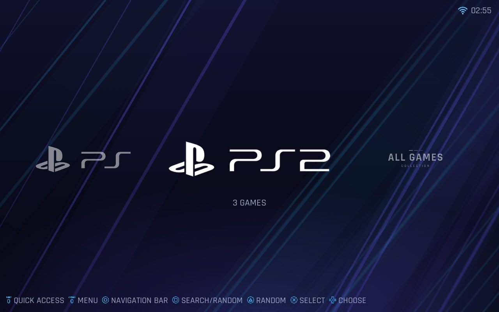
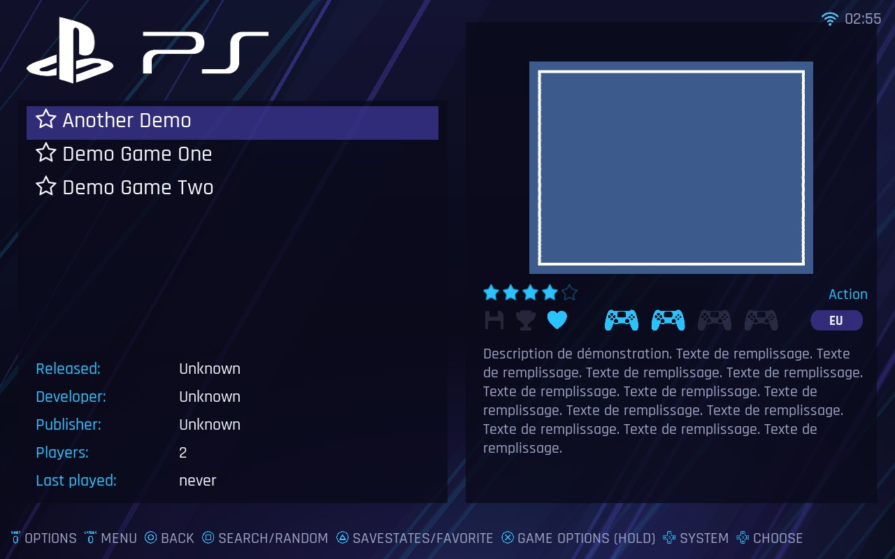
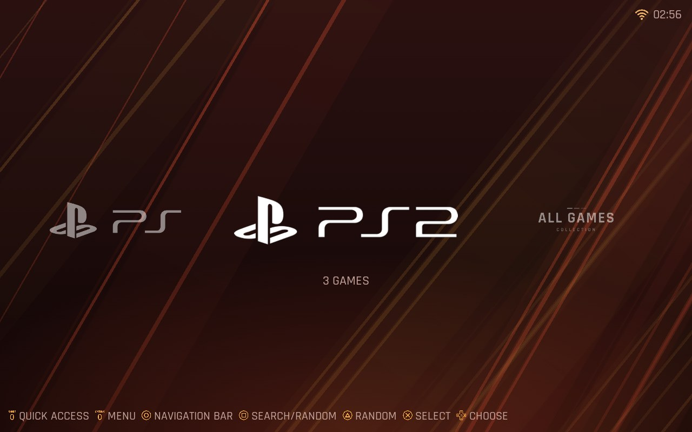
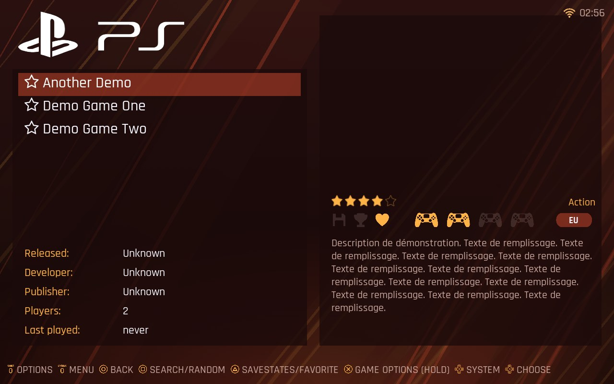

<p align="center">
  
</p>

<p align="center"><a href="README.md">🇫🇷 Français</a> &nbsp;·&nbsp; <a href="README.en.md">🇬🇧 English</a> &nbsp;·&nbsp; <b>🇩🇪 Deutsch</b></p>

# ES-NE

Standalone-Version von [batocera-emulationstation](https://github.com/batocera-linux/batocera-emulationstation)
für Arch Linux / CachyOS, mit den Optionen von RetroBat, **ganz ohne Abhängigkeit von Batocera**.

- Klassische Linux-Verzeichnisstruktur (XDG), kein `/userdata`
- Frontend: gepatchter EmulationStation-Fork (Build-Variante `ESNE`), als Submodul
- Launcher `es-launcher` (ersetzt `emulatorlauncher` / `batocera-configgen`)
- Systemwerkzeug `esctl` (ersetzt die `batocera-*`-Tools): Auflösung, Audio, Zeitzone, BIOS...
- Gleiches Schlüsselformat wie `batocera.conf` (`global.ratio`, `snes.core`, `snes["spiel.zip"].shaderset`),
  damit die ES-Menüs kompatibel bleiben
- Deklarative (YAML-)Definitionen von Systemen, Emulatoren und Features

## Status
| Komponente | Zustand |
|---|---|
| ES-Frontend (Fork `emulationstation-esne`, Branch `esne`) | ✅ baut und läuft auf CachyOS (KDE Wayland). Vollständig französische Oberfläche. Patches: Option `-DESNE=ON`, Pfade (XDG-Konfiguration, Daten in `~/esne`), `LinuxApiSystem`, System herunterfahren/neu starten, ES neu starten, vereinfachtes QUIT-Menü, Zaparoo standardmäßig deaktiviert |
| `es-launcher` | ✅ Start auf einer echten Maschine validiert (SNES, N64, GameCube, Wii): RetroArch (`sdl2`-Controller, Tastenkürzel, Seitenverhältnis, Shader, Rewind...) und eigenständige Emulatoren; 341 Tests |
| `es-genconfig` | ✅ erzeugt `es_systems.cfg`, `es_features.cfg` und Shader-Sets aus dem Katalog (27 Systeme) |
| `esctl` | ✅ `has`, `version`, `resolution`, `audio`, `config`, `info`, `timezone`, `keyboard`, `install-core`, `padsinfo`, `thebezelproject`, `systems` (BIOS-Status), `swissknife --emukill`, `preupdate-gamelists-hook`. Vertrag in `docs/ESCTL_CONTRACT.md` |
| Arch-Paket (`packaging/arch/PKGBUILD`), Sitzung `ES-NE`, polkit-Regeln | ✅ Paket installiert und Login-Sitzung validiert (Plasma Login Manager, gamescope, BC-250): `es-ne-session` startet `gamescope -f -- emulationstation` (ohne `-e`, das einen schwarzen Bildschirm ergab) und protokolliert in `~/.local/state/esne/session.log`. In einer Kopie außerhalb des Repositorys bauen: `makepkg` schreibt `pkgver` um |

Details: `docs/ROADMAP.md` (Meilensteine), `PARITY.md` (Parität mit RetroBat), `docs/UPSTREAM.md` (ES-Patches).

## Pfade
**ES-Frontend** (`-DESNE=ON`):

| Rolle | Standardpfad | Überschreiben |
|---|---|---|
| Schreibgeschützte Ressourcen (Themes, Shader, `es_systems.cfg`...) | `/usr/share/esne` | `ESNE_SHARE_DIR` |
| Konfiguration (`esne.conf`, `es_settings.cfg`) | `~/.config/esne` | `ESNE_CONFIG_DIR` oder `XDG_CONFIG_HOME` |
| Daten (Roms, Bios, Spielstände, Screenshots...) | `~/esne` | `ESNE_DATA_DIR` |
| Logs | `~/.local/state/esne/logs` | `ESNE_STATE_DIR` oder `XDG_STATE_HOME` |

`emulationstation.ini` (von ES geerbt) kann weiterhin jeden Ordner überschreiben.

**Python-Launcher** (`es-launcher`): Konfiguration `~/.config/esne/esne.conf`, Daten `~/esne/`, Cache `~/.cache/esne/`
(`ESNE_CONFIG_DIR`, `ESNE_DATA_DIR`, `ESNE_CACHE_DIR`).
`paths.py` kennt außerdem `share` (`ESNE_SHARE_DIR`) und `state` (`ESNE_STATE_DIR`), wie das Frontend.

## Laufzeitabhängigkeiten (Arch / CachyOS)
Für libretro-Spiele benötigt `es-launcher`:
```bash
sudo pacman -S --needed retroarch libretro-core-info libretro-snes9x \
    retroarch-assets-ozone retroarch-assets-xmb retroarch-assets-glui \
    libretro-shaders-slang libretro-overlays
```
Die `retroarch-assets-*` liefern die Icons und Schriften des RetroArch-Menüs (ohne sie wird es mit fehlenden Ressourcen
angezeigt). Kein Autoconfig-Paket nötig: `es-launcher` verwendet den Joypad-Treiber `sdl2`.

Controller-Kürzel im Spiel (einstellbar: `hotkey_enable`, `hotkey_exit`, `hotkey_menu`):
**Select + Start** beendet das Spiel und kehrt zu ES zurück (auch bei eigenständigen Emulatoren: `es-launcher` überwacht den Controller und schließt den Emulator), **Select + R3** öffnet das RetroArch-Menü.
Optionen pro System/Spiel in ES (Seitenverhältnis, Shader, Glättung, Rewind, Video-Treiber Vulkan/OpenGL...): siehe `PARITY.md`.

## Bekannte Probleme
- **`emulationstation: symbol lookup error: /usr/lib/libjxrglue.so: undefined symbol: WMPAlloc`** (Oktober 2026): Das Paket `jxrlib` 1.4.4-3 (Arch, 12. Oktober) enthält eine `libjxrglue.so` ohne Abhängigkeit von `libjpegxr.so`, die `WMPAlloc` definiert; jedes gegen `freeimage` 3.18.0-25 gelinkte Programm, auch ES, scheitert beim Start. Der Fehler liegt im Paket, nicht in ES-NE. Getestete Lösungen: mit `LD_PRELOAD=/usr/lib/libjpegxr.so emulationstation` starten, oder auf `jxrlib` 1.4.4-1 zurückgehen (`sudo pacman -U /var/cache/pacman/pkg/jxrlib-1.4.4-1*.pkg.tar.zst`, dann `IgnorePkg = jxrlib` in `/etc/pacman.conf` bis zur Korrektur). Diagnose: `readelf -d /usr/lib/libjxrglue.so | grep NEEDED` darf nicht nur `libc.so.6` ausgeben.

## Bezels (Dekorationen)
Bezels des The Bezel Project. ES-Menü **Updates → The Bezel Project**: ein System öffnen, dann INSTALL (oder UPDATE / REMOVE). `esctl thebezelproject install snes` lädt das Systembild herunter (`~/esne/decorations/thebezelproject/systems/snes.png`): Es ist der Ersatz-Bezel und aktiviert die Bezels des Systems.
**Bezel pro Spiel**: Hat das gestartete Spiel einen eigenen Bezel im Repository (`GameBezels/<System>/<ROM-Name>.png`, gleicher Name oder gleicher Titel mit der nächstliegenden Region), ersetzt er den des Systems. Er wird beim ersten Start heruntergeladen (einige hundert KB, höchstens 5 s; ohne Netzwerk bleibt der Systembezel) und dann in `~/esne/decorations/thebezelproject/games/<System>/` aufbewahrt. `esctl thebezelproject games snes` lädt sie vorab für alle ROMs des Systems herunter. Um nur den Systembezel zu behalten: `bezel_games = 0` in der Konfiguration (global, System oder Spiel).
Im Spiel legt `es-launcher` das Bild als RetroArch-Overlay darüber und passt das Spiel in den transparenten Bereich ein (die Seitenverhältnis-Einstellung von ES wird dann ignoriert, wie bei „auto“). Option **Decoration set** (global, System oder Spiel): Auto (= The Bezel Project, falls für das System installiert), Keine, oder ein Dekorationsset; die Systemeinstellung hat Vorrang vor der globalen.
Der Spielbereich wird im Bild erkannt (integrierter PNG-Decoder, Ergebnis im Cache; `python-pillow` wird verwendet, falls installiert, oder eine vorhandene `.png.info`-Datei). Das Bild wird immer im Vollbild angezeigt; hat der Bildschirm nicht sein Seitenverhältnis (16:9 auf einem 16:10-Bildschirm), wird es gestreckt und das Spiel behält die Proportionen seines Fensters. Ab 25 % Abweichung (21:9...) wird der Bezel ignoriert, außer die Option STRETCH BEZELS steht auf Ja.

## libretro-Cores
Ein Core pro System, als **optionale** Abhängigkeit des Pakets (`pacman -Qi es-ne-git`). `es-genconfig` wählt standardmäßig für jedes System den vorrangigsten installierten Core (`src/esne/data/systems.yml`). Fehlt der gestartete Core, zeigt ES „der Core fehlt“ und **bietet die Installation an** (`esctl install-core <core>`, über pkexec und eine polkit-Regel, die auf die Whitelist der Cores aus den offiziellen Repositories beschränkt ist, ohne Passwort aus der aktiven lokalen Sitzung); AUR-Cores (Whitelist) werden von `paru` oder `yay` gebaut, falls installiert (`--sudo pkexec`: Abhängigkeiten inklusive), sonst nach `~/.cache/esne/aur` geklont, mit makepkg unter deinem Benutzer gebaut (PKGBUILD nicht geprüft, `git` und `base-devel` erforderlich, Abhängigkeiten selbst zu installieren) und von einem zweiten Root-Helfer installiert; in beiden Fällen **wird dein Passwort verlangt** (polkit `auth_admin_keep`; ohne polkit-Agent, etwa in einer gamescope-Sitzung, schlägt dieser Schritt fehl). Führe `es-genconfig` nach der Installation eines Cores erneut aus, um den Standard-Core zu aktualisieren. Offizielle Repositories: `libretro-nestopia libretro-snes9x libretro-gambatte libretro-mgba libretro-genesis-plus-gx libretro-mupen64plus-next libretro-beetle-psx libretro-beetle-pce-fast libretro-melonds libretro-ppsspp libretro-mame`. AUR (bevorzugte Cores für NES, PSX, Arcade, Atari 2600, GBA als Ersatz): `libretro-fceumm libretro-pcsx-rearmed libretro-fbneo libretro-stella libretro-gpsp`.

## Speicherstände, Netplay, komprimierte Spiele, Bildschirm
- **Spielstände (States)**: ES bietet seine State-Menüs an (einen State laden, den Autosave fortsetzen). ES wählt den Slot (`-state_slot`), kopiert den fortzusetzenden State als `<Spiel>.state.auto` und startet das Spiel mit `-autosave 1`: `es-launcher` setzt in RetroArch `state_slot`, das automatische Laden und den automatischen State-Index (Option `incrementalsavestates`, standardmäßig ja). Die States liegen in `~/esne/saves/<System>/` (ohne Unterordner pro Core: `sort_savestates_enable=false`, sonst sieht ES sie nicht). Im Spiel validiert (SNES).
- **Netplay**: Deterministische Cores (nestopia, fceumm, snes9x, bsnes, gambatte, mgba, gpsp, genesis_plus_gx, picodrive, mednafen_pce_fast, fbneo, mame, stella, pcsx_rearmed) sind in `es_systems.cfg` mit `netplay="true"` markiert. In ES aktivieren (Spielemenü → Netplay-Einstellungen), dann ein Spiel hosten oder beitreten: `es-launcher` wandelt die ES-Optionen in `--host` / `--connect` / `--port` / `--mitm-session` / `--nick` und in `netplay_*`-Einstellungen von RetroArch um (Passwörter, Zuschauer, Relay). Im Spiel nicht validiert.
- **Komprimierte Spiele**: `.zip` und `.7z` werden akzeptiert. Ein Core, der Archive liest (Arcade), erhält sie unverändert; bei den anderen wird das Spiel nach `~/.cache/esne/extract/<System>/` entpackt (nur das letzte Spiel bleibt erhalten) und wie das Archiv benannt, damit die Namen der Spielstände erhalten bleiben. Für `.7z` wird `7z` / `7zz` benötigt. Im Spiel validiert (zip).
- **Bildschirm** (`-monitor`): ES-NE gibt den in ES gewählten Bildschirm an RetroArch weiter (`video_monitor_index`). Nicht validiert (nur ein Bildschirm auf der Testmaschine).

## Scraping-Schlüssel
Standardmäßig wird nichts einkompiliert oder mitgeliefert. `es-genconfig` erzeugt `~/.config/esne/keys.conf` (Modus 600) mit einer kommentierten Vorlage: `SCREENSCRAPER_DEV_LOGIN`, `GAMESDB_APIKEY`, `CHEEVOS_DEV_LOGIN`... auskommentieren und ausfüllen, dann ES neu starten. Ein Scraper, dessen Schlüssel fehlt, erscheint nicht im Menü. Diese Datei darf nie committet werden. Deine persönlichen Zugangsdaten (ScreenScraper-Konto, RetroAchievements) gibst du in den ES-Menüs ein.

**Release-Paket** (Maintainer): `tools/build-release.sh /pfad/zu/keys.conf` baut das Arch-Paket, das in `dist/release/` (von git ignoriert) entsteht und dem GitHub-Release beizufügen ist; es wird mit `sudo pacman -U` installiert. Die Schlüsseldatei wird nie committet. Die `keys.conf` des Benutzers hat weiterhin Vorrang. Auf CachyOS mit Release 1.0.0 validiert: Die Scraper funktionieren ohne `keys.conf` und ohne persönliche Zugangsdaten.

## Theme und kostenlose Spiele

<table>
  <tr>
    <td></td>
    <td></td>
  </tr>
  <tr>
    <td></td>
    <td></td>
  </tr>
</table>

Das Paket fügt **ES-NE** dem Anwendungsmenü hinzu (Kategorie Spiele, ES-Icon), zusätzlich zum Eintrag der Login-Sitzung.
Das Paket liefert das Theme **ES-NE** (für dieses Projekt entwickelt) in `/usr/share/esne/themes`: Es ist das Standard-Theme für alle 27 Systeme, mit zwei Stimmungen (Nuit, Braise) und drei Tastensymbol-Sätzen (ES, Xbox, PlayStation), wählbar unter Benutzeroberfläche → Theme. Die Konsolenlogos stammen aus [Monochrome Gaming Logos](https://github.com/HVR88/Monochrome-Gaming-Logos) (nicht kommerzielle Nutzung; siehe `docs/THIRD_PARTY.md`). Eigene Themes kommen nach `~/esne/themes`.
Das System **Ports** startet `.sh`-Skripte (`~/esne/roms/ports/`). Es wird kein Spiel mitgeliefert: `es-genconfig --install-port digger` lädt **Digger** (0,5 MB, GPL-2.0, x86_64 und aarch64) aus dem [PortMaster](https://github.com/PortsMaster/PortMaster-New)-Katalog herunter und erstellt den Starter (`--list-ports` listet die angebotenen Spiele auf). Nur der Spielordner wird übernommen, ohne PortMaster. Spiele, die nur eine Tastatur akzeptieren, lassen sich dank `esne-padkeys`, dem Äquivalent zu `gptokeyb`, mit dem Controller spielen: Es liest die `.gptk`-Datei des Spiels (`a = enter`, `left_analog_up = up`, `mouse_movement_*`, `mouse_left`...), liest die Controller (evdev) und erzeugt eine virtuelle Tastatur/Maus (uinput). Das Paket lädt das Modul `uinput` und gewährt Zugriff auf `/dev/uinput` der Sitzung (udev-Regel). Ist uinput nicht nutzbar, startet das Spiel trotzdem, ohne Übersetzung. Direkter Aufruf: `esne-padkeys spiel.gptk -- ./spiel` (`--grab` für exklusiven Zugriff auf die Controller, auf Kosten des ES-NE-Beenden-Kürzels). `es-genconfig` überschreibt nie einen vorhandenen Starter; die Liste steht in `src/esne/data/ports.yml` (ergänzbar durch `~/.config/esne/ports.yml`, Formen `command:` für ein installiertes Programm oder `portmaster:`).

## `es_systems.cfg` erzeugen
```bash
es-genconfig                    # schreibt ~/.config/esne/es_systems.cfg (alle Systeme des Katalogs) + Rom-Ordner
es-genconfig --installed-only   # nur Systeme, für die ein libretro-Core installiert ist
es-genconfig --stdout           # gibt es_systems.cfg aus, ohne etwas zu schreiben
```
`es-genconfig` schreibt außerdem `es_features.cfg` (Optionen pro System/Spiel: Seitenverhältnis, Glättung, Rewind, Auto-Speichern, Pixel Perfect,
Shader) und erstellt die Shader-Sets in `~/esne/shaders/configs/` für die installierten libretro-Presets
(`libretro-shaders-slang`). Die Systeme stammen aus `src/esne/data/systems.yml` (ergänzt durch `~/.config/esne/systems.yml`). Lege deine Roms in
`~/esne/roms/<System>/` ab; ES blendet leere Systeme aus.

## Systeme und Emulatoren
27 Systeme: 8/16-Bit-Konsolen bis GameCube, Dreamcast, PSP, PS2/PS3, Wii/Wii U, Switch, Xbox, Xbox 360, dazu `steam` und `windows`.
- **libretro** (NES bis PS1, N64, PSP, Arcade...): Cores in `systems.yml` gewählt.
- **Eigenständig** (in `emulators.yml` beschrieben, von `generators/standalone.py` gestartet): Dolphin (GameCube, Wii; ES-Einstellungen in `Dolphin.ini`, `GFX.ini` und der SYSCONF; SDL-Controller: GameCube mit 2 Spielern, Wii als Classic Controller oder emulierte Wiimote + Nunchuk, oder echte Wiimotes), PCSX2 (PS2),
  RPCS3 (PS3), Cemu (Wii U), Eden oder Ryujinx (Switch), xemu (Xbox), Xenia Canary (Xbox 360), Redream (Dreamcast), RMG (Rosalie's Mupen GUI, N64), PPSSPP (PSP) DuckStation (PS1) und Snes9x (SNES) als Alternative zu den libretro-Cores, Steam (Start und Controller validiert; `.steam`-Dateien mit der appid, von `es-genconfig` für jedes installierte Spiel erstellt: Steam-Bibliotheken und `libraryfolders.vdf` werden gelesen, Proton und Tools aussortiert; `esne-steam-run` wartet auf das Ende des Spiels, da Steam sofort zurückkehrt, und das Kürzel Select+Start schließt den ganzen Spielbaum (Proton inklusive) und gibt die Kontrolle an ES zurück; der von ES-NE geöffnete Steam-Client wird am Ende des Spiels geschlossen, Option KEEP STEAM OPEN, um ihn zu behalten),
  Wine oder umu-run (`windows`). Sie starten im Vollbild ohne Oberfläche. Die nützlichsten Grafik- und Konsoleneinstellungen werden in ES gewählt (Details pro Emulator unten); für alles Weitere die eigene Konfiguration des Emulators verwenden.
  **PCSX2** (Controller und ES-Einstellungen im Spiel mit Final Fantasy XII validiert, AppImage; nach einem Paket-Update `es-genconfig` erneut ausführen, um die neuen Optionen zu sehen, was die ES-NE-Sitzung bereits tut): ES-NE schreibt die Abschnitte `[Pad1]`/`[Pad2]` in `~/.config/PCSX2/inis/PCSX2.ini` neu (Controller über SDL-Nummer bezeichnet, keine GUID) und wendet Grafik-API, Auflösung, Seitenverhältnis, VSync und FXAA an, ebenso anisotrope Filterung, Texturfilterung, CAS-Schärfe, Dithering, 16:9- und Anti-Interlacing-Patches, Bildzähler, Lautstärke, Stummschaltung und RetroAchievements (nach einer echten `PCSX2.ini` geschrieben; nur RetroAchievements wurde im Spiel nicht ausprobiert). PCSX2 vorher einmal von Hand starten (Assistent, BIOS in `~/esne/bios/ps2`).
  **RPCS3** (Controller im Spiel validiert): ES-NE schreibt `input_configs/global/Default.yml` (SDL-Handler, ein Eintrag pro Controller) und wendet Grafik-API, Auflösung, Seitenverhältnis und VSync auf `config.yml` an. RPCS3 vorher einmal von Hand starten (Firmware, Konfiguration). Ein Ordner `Name.ps3` wird über seine `EBOOT.BIN` gestartet.
  **Eden** (im Spiel validiert, 2 PS4-Controller, AppImage): Konfiguriere den Controller von Spieler 1 einmal in Eden; ES-NE kopiert diese Belegung auf die anderen Controller desselben Modells, mit der GUID, die Eden sieht (die von ES, Namens-CRC auf null) (`qt-config.ini`, Option `AUTOCONFIGURE CONTROLLERS`). In ES gewählte Einstellungen, die bei Definition in `qt-config.ini` geschrieben werden (eine nicht gewählte Einstellung behält den Wert von Eden): Dock- oder Handheld-Modus, Auflösung (1X bis 4X), anisotrope Filterung (automatisch, Standard, 2x bis 16x), VSync-Modus, Kantenglättung, Skalierungsfilter, Bildformat, Sprache und Region der Konsole (im Spiel validiert).
  **Cemu** ist eine Ausnahme (im Spiel validiert: Mario Kart 8, 2 PS4-Controller): ES-NE erzeugt die „Wii U Pro Controller“-Profile (`controllerProfiles/controllerN.xml`) aus den Controllern von ES und wendet auf `settings.xml` die Option `GRAPHICS API` (Vulkan/OpenGL) und die in ES gewählten Einstellungen an: Konsolensprache, VSync, Upscale-Filter, Vollbild-Streckung, TV-Lautstärke und Bildzähler (im Spiel validiert). Cemu vorher einmal von Hand starten (Erststart-Assistent, Schlüssel und MLC-Ordner) und den Controller einmal in Cemu konfigurieren: ES (SDL2) und Cemu (SDL3) berechnen nicht dieselbe GUID, ES-NE übernimmt die, die Cemu für dasselbe Modell gespeichert hat. AppImage (`~/.local/bin/Cemu*.AppImage`), Paket oder Flatpak werden erkannt; mit der Option `AUTOCONFIGURE CONTROLLERS` behältst du deine eigene Belegung.
**xemu (Xbox)**: Lege die Systemdateien in `~/esne/bios/xbox` (oder `Xbox`) ab (512-Byte-MCPX-Boot-ROM, 256-Byte-EEPROM, Flash-BIOS, Festplatte `.qcow2`; sie werden an ihrer Größe erkannt, nicht an ihrem Namen), starte xemu einmal von Hand, damit es `xemu.toml` erzeugt, dann trägt ES-NE diese Dateien und die Controller dort ein (der Vollbildmodus kommt von der Kommandozeile) (Option AUTOCONFIGURE CONTROLLERS). Die Optionen RENDER RESOLUTION (Render-Skalierung 1X bis 4X) und ASPECT RATIO (nativ, auto, 4:3, 16:9) werden in `[display.quality]` und `[display.ui]` geschrieben (im Spiel validiert). xemu ist nicht in den offiziellen Repositories: Das **AppImage** wird in `~/.local/bin` oder `~/Applications` gefunden (Name `xemu*.AppImage`, ausführbar gemacht), sonst AUR `xemu` oder Flatpak `app.xemu.xemu`.

Ein fehlender Emulator ergibt den Fehler 204 mit dem Namen des zu installierenden Pakets. **Xbox 360** (experimentell; Start einer `.iso`, Vollbild, Controller und Videoeinstellungen im Spiel validiert): Xenia Canary hat keine offizielle Linux-Binärdatei; ES-NE erkennt das AppImage des nativen Linux-Forks ([peerloomllc/xenia-canary](https://github.com/peerloomllc/xenia-canary/releases)) in `~/.local/bin` oder `~/Applications` (Name `xenia*.AppImage`). ES-NE startet das Spiel (`.iso` oder `.xex`) mit `--fullscreen=true`; Videoeinstellungen (Render-Auflösung, VSync, Kantenglättung, FSR/CAS, anisotrope Filterung, Bildratenbegrenzung) werden in ES gewählt und über die Kommandozeile übergeben, ohne die Konfiguration von Xenia anzutasten (im Spiel validiert); Sprache und Region der Konsole (in `xconfig.settings` geschrieben, der Binärdatei der internen Xbox-360-Einstellungen, an Bytes, die aus einer echten Datei abgelesen wurden: Sprachen Englisch, Japanisch, Deutsch, Französisch, Spanisch, Italienisch, Koreanisch, Russisch, traditionelles Chinesisch und die übrigen in der Reihenfolge der Konsole; Regionen Frankreich, Deutschland, Spanien, Italien, Vereinigtes Königreich, Vereinigte Staaten, Japan, Niederlande, Russland, Tschechien), Ton (Stummschaltung, Audiosystem), Videomodus der Konsole (`avpack`: HDMI, VGA, Komponente, SCART, PAL-60) und Videooptionen, alle im Spiel validiert; Controller und alles Übrige werden in der eigenen Konfiguration von Xenia vorgenommen (`~/.local/share/Xenia/xenia-canary.config.toml`). Xenia vorher einmal von Hand starten.

**DuckStation (PS1)** (im Spiel validiert; nach einer echten `settings.ini` geschrieben): AppImage in `~/.local/bin` oder `~/Applications` (`DuckStation*.AppImage`; Paket `duckstation-qt` oder Flatpak werden ebenfalls akzeptiert), in ES zusätzlich zu den libretro-Cores angeboten. Es startet mit `-batch -fullscreen --`; ES-NE wendet auf `~/.local/share/duckstation/settings.ini` die Grafik-Engine, Auflösung, MSAA, Texturfilterung, PGXP, den Widescreen-Hack, das Bildformat, VSync, den Bildzähler, die Stummschaltung, die Nachfrage und das automatische Speichern beim Beenden an und schreibt `Pad1`/`Pad2` neu (analoger Controller, Option `AUTOCONFIGURE CONTROLLERS`; kein Multitap).

**Snes9x (SNES)** (im Spiel validiert: Vollbild, PS4-Controller, Beenden mit Select+Start; nach einer echten `snes9x.conf` der Version 1.63 geschrieben): AppImage in `~/.local/bin` oder `~/Applications` (`Snes9x*.AppImage`; Paket `snes9x-gtk` oder Flatpak werden ebenfalls akzeptiert), in ES zusätzlich zu den libretro-Cores angeboten. ES-NE erzwingt beim Öffnen eines Spiels den Vollbildmodus und wendet auf `~/.config/snes9x/snes9x.conf` Grafiktreiber, Bildformat, bilinearen Filter, VSync, Hochauflösungseffekt, Scanlines, Bildzähler, Stummschaltung, Rewind, Aufhebung des Sprite-Limits und CPU-Übertaktung an. Controller: integriertes Profil für Sony-Controller (an einem PS4-Controller gemessen), für jeden ES-Controller geschrieben; bei einem anderen Modell den Controller von Spieler 1 einmal in Snes9x konfigurieren, ES-NE kopiert diese Belegung (Option `AUTOCONFIGURE CONTROLLERS`); Option DIRECTIONS: Steuerkreuz (Standard) oder linker Stick.

**RMG (N64) und PPSSPP (PSP)** (im Spiel validiert; nach echten Konfigurationsdateien geschrieben): Die AppImages kommen nach `~/.local/bin` oder `~/Applications` (Namen `RMG*.AppImage` und `PPSSPP*.AppImage`; Paket oder Flatpak werden ebenfalls akzeptiert). Sie werden in ES zusätzlich zu den libretro-Cores angeboten, die die Standardwahl bleiben. Jeden einmal von Hand starten, um seine Konfiguration zu erzeugen. **RMG** startet mit `-f -n -q` (Vollbild, ohne Menüs, es schließt sich am Ende des Spiels); ES-NE schreibt die Controller-Profile in `~/.config/RMG/mupen64plus.cfg` neu (4 Spieler; Option `AUTOCONFIGURE CONTROLLERS`) und wendet auf `GLideN64.ini` Auflösung, Bildformat, MSAA, FXAA, anisotrope Filterung, Texturfilterung, hochauflösende Texturen, VSync und Bildzähler an. **PPSSPP** startet mit `--fullscreen --pause-menu-exit`, erkennt SDL-Controller selbst, und ES-NE wendet auf `ppsspp.ini` die Grafik-Engine (Vulkan, OpenGL), Auflösung, anisotrope Filterung, Texturfilterung, VSync, Frame-Skipping, Bildzähler, Stummschaltung und Konsolensprache an.

**Dreamcast**: Redream ist nicht in den offiziellen Repositories; lege sein Linux-Archiv ([redream.io](https://redream.io)) in `~/.local/bin` (Binärdatei `redream`, direkter Pfad akzeptiert) oder in `~/Applications` ab. ES-NE startet das Spiel (`.gdi`, `.cdi`, `.chd` oder `.cue`); der Vollbildmodus kommt aus der Konfiguration von Redream (`redream.cfg`, beim ersten Start erzeugt, gesucht im XDG-Datenordner, im XDG-Konfigurationsordner, in `~/.redream` und dann neben der Binärdatei). In ES gewählte und in `redream.cfg` geschriebene Einstellungen: Region, Konsolensprache, TV-Norm (PAL, NTSC, PAL-M, PAL-N), Kabel (VGA, RGB, Composite), Bildformat, Auflösung (640x480 bis 3840x2880), VSync, Renderer (Vulkan, OpenGL), Frame-Skipping und Bildzähler (im Spiel validiert).

## Das Frontend kompilieren
```bash
git clone --recurse-submodules https://github.com/JyuHo/ES-NE.git
cd ES-NE/third_party/emulationstation
cmake -B build -DESNE=ON -DGL=ON
cmake --build build -j"$(nproc)"
```
Build-Abhängigkeiten: SDL2, SDL2_mixer, FreeImage, FreeType, cURL, RapidJSON, LibVLC, ALSA (siehe `docs/UPSTREAM.md`).
Nach einem `git pull` nicht vergessen: `git submodule update --init`.

## `esctl`
Systemwerkzeug, das ES anstelle der `batocera-*`-Tools aufruft (siehe `docs/ESCTL_CONTRACT.md`):
```bash
esctl commands            # auf dieser Maschine nutzbare Befehle
esctl has audio           # Exit-Code 0, wenn verfügbar
esctl resolution listModes
esctl audio list
esctl timezone get          # set kann eine polkit-Regel erfordern
esctl keyboard list-layouts # Tastaturlayouts (localectl); set <Layout> [Variante]
esctl install-core fceumm   # installiert einen libretro-Core (pacman, paru/yay für das AUR)
esctl padsinfo              # Controller und Batterien, im von ES gelesenen Format
```
Ohne Installation: `PYTHONPATH=src python -m esne.esctl commands`.

## Entwicklung (Python-Launcher und esctl)
```bash
python -m venv .venv && . .venv/bin/activate
pip install pytest && pytest        # die Tests finden src/ von selbst
pip install -e '.[dev]'              # installiert auch es-launcher und esctl (baut evdev)
```

## Lizenz
GPL-3.0-or-later. Siehe `LICENSE` und `docs/LICENSING.md`. Der ES-Fork steht unter MIT.
