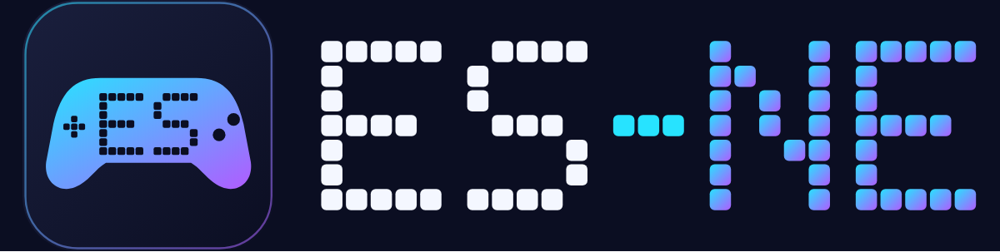

<p align="center">
  
</p>

<p align="center"><b>🇫🇷 Français</b> &nbsp;·&nbsp; <a href="README.en.md">🇬🇧 English</a> &nbsp;·&nbsp; <a href="README.de.md">🇩🇪 Deutsch</a></p>

# ES-NE

Version standalone de [batocera-emulationstation](https://github.com/batocera-linux/batocera-emulationstation)
pour Arch Linux / CachyOS, avec les options de RetroBat, **sans aucune dépendance à Batocera**.

- Arborescence Linux classique (XDG), pas de `/userdata`
- Frontend: fork d'EmulationStation patché (variante de build `ESNE`), en sous-module
- Lanceur `es-launcher` (remplace `emulatorlauncher` / `batocera-configgen`)
- Outil système `esctl` (remplace les `batocera-*`): résolution, audio, fuseau horaire, BIOS...
- Même format de clés que `batocera.conf` (`global.ratio`, `snes.core`, `snes["jeu.zip"].shaderset`)
  pour rester compatible avec les menus d'ES
- Définitions déclaratives (YAML) des systèmes, émulateurs et features

## Statut
| Composant | État |
|---|---|
| Frontend ES (fork `emulationstation-esne`, branche `esne`) | ✅ compile et tourne sur CachyOS (KDE Wayland). Interface en français complète. Patchs: option `-DESNE=ON`, chemins (config XDG, données dans `~/esne`), `LinuxApiSystem`, arrêt/redémarrage système, redémarrage d'ES, menu QUIT simplifié, Zaparoo désactivé par défaut |
| `es-launcher` | ✅ lancement validé sur une vraie machine (SNES, N64, GameCube, Wii): RetroArch (manette `sdl2`, raccourcis, ratio, shaders, rewind...) et émulateurs autonomes; 341 tests |
| `es-genconfig` | ✅ génère `es_systems.cfg`, `es_features.cfg` et les jeux de shaders depuis le catalogue (27 systèmes) |
| `esctl` | ✅ `has`, `version`, `resolution`, `audio`, `config`, `info`, `timezone`, `keyboard`, `install-core`, `padsinfo`, `thebezelproject`, `systems` (état des BIOS), `swissknife --emukill`, `preupdate-gamelists-hook`. Contrat dans `docs/ESCTL_CONTRACT.md` |
| Paquet Arch (`packaging/arch/PKGBUILD`), session `ES-NE`, règles polkit | ✅ paquet installé et session de connexion validée (Plasma Login Manager, gamescope, BC-250): `es-ne-session` lance `gamescope -f -- emulationstation` (sans `-e`, qui donnait un écran noir) et journalise dans `~/.local/state/esne/session.log`. Compiler dans une copie hors du dépôt: `makepkg` réécrit `pkgver` |

Détails: `docs/ROADMAP.md` (jalons), `PARITY.md` (parité avec RetroBat), `docs/UPSTREAM.md` (patchs d'ES).

## Chemins
**Frontend ES** (`-DESNE=ON`):

| Rôle | Chemin par défaut | Surcharge |
|---|---|---|
| Ressources en lecture seule (thèmes, shaders, `es_systems.cfg`...) | `/usr/share/esne` | `ESNE_SHARE_DIR` |
| Config (`esne.conf`, `es_settings.cfg`) | `~/.config/esne` | `ESNE_CONFIG_DIR` ou `XDG_CONFIG_HOME` |
| Données (roms, bios, saves, screenshots...) | `~/esne` | `ESNE_DATA_DIR` |
| Logs | `~/.local/state/esne/logs` | `ESNE_STATE_DIR` ou `XDG_STATE_HOME` |

`emulationstation.ini` (hérité d'ES) peut encore surcharger chaque dossier.

**Lanceur Python** (`es-launcher`): config `~/.config/esne/esne.conf`, données `~/esne/`, cache `~/.cache/esne/`
(`ESNE_CONFIG_DIR`, `ESNE_DATA_DIR`, `ESNE_CACHE_DIR`).
`paths.py` connaît aussi `share` (`ESNE_SHARE_DIR`) et `state` (`ESNE_STATE_DIR`), comme le frontend.

## Dépendances d'exécution (Arch / CachyOS)
Pour les jeux libretro, `es-launcher` a besoin de:
```bash
sudo pacman -S --needed retroarch libretro-core-info libretro-snes9x \
    retroarch-assets-ozone retroarch-assets-xmb retroarch-assets-glui \
    libretro-shaders-slang libretro-overlays
```
Les `retroarch-assets-*` fournissent les icônes et polices du menu RetroArch (sans eux il s'affiche avec des ressources
manquantes). Aucun paquet autoconfig n'est nécessaire: `es-launcher` utilise le pilote joypad `sdl2`.

Raccourcis manette en jeu (réglables: `hotkey_enable`, `hotkey_exit`, `hotkey_menu`):
**Select + Start** quitte le jeu et revient à ES (aussi pour les émulateurs autonomes: `es-launcher` surveille la manette et ferme l'émulateur), **Select + R3** ouvre le menu RetroArch.
Options par système/jeu dans ES (ratio, shaders, lissage, rewind, pilote vidéo Vulkan/OpenGL...): voir `PARITY.md`.

## Problèmes connus
- **`emulationstation: symbol lookup error: /usr/lib/libjxrglue.so: undefined symbol: WMPAlloc`** (octobre 2026): le paquet `jxrlib` 1.4.4-3 (Arch, 12 octobre) a une `libjxrglue.so` sans dépendance sur `libjpegxr.so`, qui définit `WMPAlloc`; tout programme lié à `freeimage` 3.18.0-25, dont ES, échoue au démarrage. Le défaut est dans le paquet, pas dans ES-NE. Solutions testées: lancer avec `LD_PRELOAD=/usr/lib/libjpegxr.so emulationstation`, ou revenir à `jxrlib` 1.4.4-1 (`sudo pacman -U /var/cache/pacman/pkg/jxrlib-1.4.4-1*.pkg.tar.zst`, puis `IgnorePkg = jxrlib` dans `/etc/pacman.conf` jusqu'au correctif). Diagnostic: `readelf -d /usr/lib/libjxrglue.so | grep NEEDED` ne doit pas se limiter à `libc.so.6`.

## Bezels (décorations)
Bezels de The Bezel Project. Menu ES **Mises à jour → The Bezel Project**: ouvrir un système puis INSTALL (ou UPDATE / REMOVE). `esctl thebezelproject install snes` télécharge l'image du système (`~/esne/decorations/thebezelproject/systems/snes.png`): c'est le bezel de repli et ce qui active les bezels du système.
**Bezel par jeu**: quand le jeu lancé a son propre bezel dans le dépôt (`GameBezels/<système>/<nom de la ROM>.png`, nom identique ou même titre avec la région la plus proche), il remplace celui du système. Il est téléchargé au premier lancement (quelques centaines de Ko, 5 s maximum, sans réseau on garde le bezel du système) puis gardé dans `~/esne/decorations/thebezelproject/games/<système>/`. `esctl thebezelproject games snes` les télécharge d'avance pour toutes les ROM du système. Pour ne garder que le bezel du système: `bezel_games = 0` dans la configuration (global, système ou jeu).
En jeu, `es-launcher` pose l'image en overlay RetroArch et cadre le jeu dans la zone transparente (le réglage de ratio d'ES est alors ignoré, comme en « auto »). Option **Decoration set** (global, système ou jeu): Auto (= The Bezel Project s'il est installé pour le système), Aucun, ou un jeu de décorations; le réglage du système prime sur le global.
La zone de jeu est détectée dans l'image (décodeur PNG intégré, résultat mis en cache; `python-pillow` est utilisé s'il est installé, ou un fichier `.png.info` si présent). L'image est toujours affichée en plein écran; si l'écran n'a pas son ratio (16:9 sur un écran 16:10), elle est étirée et le jeu garde les proportions de sa fenêtre. Au-delà de 25 % d'écart (21:9...), le bezel est ignoré sauf option STRETCH BEZELS sur Oui.

## Cores libretro
Un core par système, en dépendance **optionnelle** du paquet (`pacman -Qi es-ne-git`). `es-genconfig` choisit par défaut, pour chaque système, le core installé le plus prioritaire (`src/esne/data/systems.yml`). Si le core lancé est absent, ES affiche « le cœur est manquant » et **propose de l'installer** (`esctl install-core <core>`, via pkexec et une règle polkit limitée à la liste blanche des cores des dépôts officiels, sans mot de passe depuis la session locale active); les cores de l'AUR (liste blanche) sont construits par `paru` ou `yay` s'il est installé (`--sudo pkexec`: dépendances comprises), sinon clonés dans `~/.cache/esne/aur`, construits avec makepkg sous ton utilisateur (PKGBUILD non relu, `git` et `base-devel` requis, dépendances à installer toi-même) et installés par une seconde aide root; dans les deux cas **ton mot de passe est exigé** (polkit `auth_admin_keep`; sans agent polkit, par exemple en session gamescope, cette étape échoue). Relance `es-genconfig` après l'installation d'un core pour mettre à jour le core par défaut. Dépôts officiels: `libretro-nestopia libretro-snes9x libretro-gambatte libretro-mgba libretro-genesis-plus-gx libretro-mupen64plus-next libretro-beetle-psx libretro-beetle-pce-fast libretro-melonds libretro-ppsspp libretro-mame`. AUR (cores préférés pour NES, PSX, arcade, Atari 2600, GBA de secours): `libretro-fceumm libretro-pcsx-rearmed libretro-fbneo libretro-stella libretro-gpsp`.

## États de sauvegarde, netplay, jeux compressés, écran
- **États**: ES propose ses menus d'états (charger un état, reprendre l'auto-sauvegarde). ES choisit le slot (`-state_slot`), copie l'état à reprendre en `<jeu>.state.auto` et lance le jeu avec `-autosave 1`: `es-launcher` règle `state_slot`, le chargement automatique et l'index automatique des états (option `incrementalsavestates`, oui par défaut) de RetroArch. Les états sont dans `~/esne/saves/<système>/` (sans sous-dossier par core: `sort_savestates_enable=false`, sinon ES ne les voit pas). Validé en jeu (SNES).
- **Netplay**: les cores déterministes (nestopia, fceumm, snes9x, bsnes, gambatte, mgba, gpsp, genesis_plus_gx, picodrive, mednafen_pce_fast, fbneo, mame, stella, pcsx_rearmed) sont marqués `netplay="true"` dans `es_systems.cfg`. Active-le dans ES (menu des jeux → réglages du netplay) puis héberge ou rejoins une partie: `es-launcher` convertit les options d'ES en `--host` / `--connect` / `--port` / `--mitm-session` / `--nick` et en réglages `netplay_*` de RetroArch (mots de passe, spectateur, relais). Non validé en jeu.
- **Jeux compressés**: `.zip` et `.7z` sont acceptés. Un core qui lit les archives (arcade) les reçoit telles quelles; pour les autres, le jeu est extrait dans `~/.cache/esne/extract/<système>/` (seul le dernier jeu est gardé), renommé comme l'archive pour garder le nom des sauvegardes. Il faut `7z` / `7zz` pour les `.7z`. Validé en jeu (zip).
- **Écran** (`-monitor`): ES-NE transmet l'écran choisi dans ES à RetroArch (`video_monitor_index`). Non validé (un seul écran sur la machine de test).

## Clés de scraping
Par défaut, rien n'est compilé ni empaqueté. `es-genconfig` crée `~/.config/esne/keys.conf` (mode 600) avec un modèle commenté: décommente et remplis `SCREENSCRAPER_DEV_LOGIN`, `GAMESDB_APIKEY`, `CHEEVOS_DEV_LOGIN`..., puis redémarre ES. Un scraper dont la clé manque n'apparaît pas dans le menu. Ce fichier ne doit jamais être commité. Tes identifiants personnels (compte ScreenScraper, RetroAchievements) se saisissent dans les menus d'ES.

**Paquet de release** (mainteneur): `tools/build-release.sh /chemin/vers/keys.conf` construit le paquet Arch, produit dans `dist/release/` (ignoré par git) et à joindre à la release GitHub; il s'installe avec `sudo pacman -U`. Le fichier de clés n'est jamais commité. Le `keys.conf` de l'utilisateur reste prioritaire. Validé sur CachyOS avec la release 1.0.0: les scrapers fonctionnent sans `keys.conf` ni identifiant personnel.

## Thème et jeu libre
Le paquet ajoute **ES-NE** au menu des applications (catégorie Jeux, icône ES), en plus de l'entrée de session de connexion.
Le paquet livre le thème **Carbon** (RetroPie) dans `/usr/share/esne/themes`: ES le choisit seul tant qu'aucun autre thème n'est sélectionné (menu Interface utilisateur → Thème). Tes propres thèmes vont dans `~/esne/themes`.
Le système **Ports** lance des scripts `.sh` (`~/esne/roms/ports/`). Aucun jeu n'est livré: `es-genconfig --install-port digger` télécharge **Digger** (0,5 Mo, GPL-2.0, x86_64 et aarch64) depuis le catalogue [PortMaster](https://github.com/PortsMaster/PortMaster-New) et crée son lanceur (`--list-ports` liste les jeux proposés). Seul le dossier du jeu est repris, sans PortMaster. Les jeux qui n'acceptent que le clavier se jouent à la manette grâce à `esne-padkeys`, équivalent de `gptokeyb`: il lit le fichier `.gptk` du jeu (`a = enter`, `left_analog_up = up`, `mouse_movement_*`, `mouse_left`...), lit les manettes (evdev) et émet un clavier/souris virtuel (uinput). Le paquet charge le module `uinput` et donne l'accès au `/dev/uinput` de la session (règle udev). Si uinput est inutilisable, le jeu se lance quand même, sans traduction. Usage direct: `esne-padkeys jeu.gptk -- ./jeu` (`--grab` pour un accès exclusif aux manettes, au prix du raccourci de sortie d'ES-NE). `es-genconfig` n'écrase jamais un lanceur existant; la liste est dans `src/esne/data/ports.yml` (complétable par `~/.config/esne/ports.yml`, formes `command:` pour un programme installé ou `portmaster:`).

## Générer `es_systems.cfg`
```bash
es-genconfig                    # écrit ~/.config/esne/es_systems.cfg (tous les systèmes du catalogue) + dossiers de roms
es-genconfig --installed-only   # seulement les systèmes dont un core libretro est installé
es-genconfig --stdout           # affiche es_systems.cfg sans rien écrire
```
`es-genconfig` écrit aussi `es_features.cfg` (options par système/jeu: ratio, lissage, rewind, sauvegarde auto, pixel perfect,
shaders) et crée les jeux de shaders dans `~/esne/shaders/configs/` pour les presets libretro installés
(`libretro-shaders-slang`). Les systèmes viennent de `src/esne/data/systems.yml` (complété par `~/.config/esne/systems.yml`). Mets tes roms dans
`~/esne/roms/<système>/`; ES masque les systèmes vides.

## Systèmes et émulateurs
27 systèmes: consoles 8/16 bits à la GameCube, Dreamcast, PSP, PS2/PS3, Wii/Wii U, Switch, Xbox, Xbox 360, plus `steam` et `windows`.
- **libretro** (NES à PS1, N64, PSP, arcade...): cores choisis dans `systems.yml`.
- **Autonomes** (décrits dans `emulators.yml`, lancés par `generators/standalone.py`): Dolphin (GameCube, Wii; réglages ES dans `Dolphin.ini`, `GFX.ini` et la SYSCONF; manettes SDL: GameCube à 2 joueurs, Wii en Classic Controller ou Wiimote + Nunchuk émulés, ou vraies Wiimotes), PCSX2 (PS2),
  RPCS3 (PS3), Cemu (Wii U), Eden ou Ryujinx (Switch), xemu (Xbox), Xenia Canary (Xbox 360), Redream (Dreamcast), RMG (Rosalie's Mupen GUI, N64), PPSSPP (PSP) DuckStation (PS1) et Snes9x (SNES) en alternative aux cores libretro, Steam (lancement et manette validés; fichiers `.steam` contenant l'appid, créés par `es-genconfig` pour chaque jeu installé: bibliothèques de Steam et `libraryfolders.vdf` lus, Proton et outils écartés; `esne-steam-run` attend la fin de la partie, car Steam rend la main tout de suite, et le raccourci Select+Start ferme tout l'arbre du jeu (Proton compris) et rend la main à ES; le client Steam ouvert par ES-NE est refermé à la fin de la partie, option KEEP STEAM OPEN pour le garder),
  Wine ou umu-run (`windows`). Ils se lancent en plein écran sans interface. Les réglages graphiques et de console les plus utiles se choisissent dans ES (détail par émulateur ci-dessous); pour le reste, utilise la configuration propre de l'émulateur.
  **PCSX2** (manette et réglages d'ES validés en jeu avec Final Fantasy XII, AppImage; après une mise à jour du paquet, relancer `es-genconfig` pour voir les nouvelles options, ce que fait déjà la session ES-NE): ES-NE réécrit les sections `[Pad1]`/`[Pad2]` de `~/.config/PCSX2/inis/PCSX2.ini` (manettes désignées par numéro SDL, pas de GUID) et applique API graphique, résolution, ratio, vsync et FXAA, ainsi que le filtrage anisotrope, le filtrage des textures, la netteté CAS, le dithering, les patchs 16:9 et sans entrelacement, le compteur d'images, le volume, la coupure du son et les RetroAchievements (écrits d'après un `PCSX2.ini` réel; seuls les RetroAchievements n'ont pas été essayés en jeu). Lancer PCSX2 une fois à la main avant (assistant, BIOS dans `~/esne/bios/ps2`).
  **RPCS3** (manettes validées en jeu): ES-NE écrit `input_configs/global/Default.yml` (gestionnaire SDL, une entrée par manette) et applique API graphique, résolution, ratio et vsync à `config.yml`. Lancer RPCS3 une fois à la main avant (firmware, configuration). Un dossier `Nom.ps3` est lancé par son `EBOOT.BIN`.
  **Eden** (validé en jeu, 2 manettes PS4, AppImage): configure la manette du joueur 1 dans Eden une fois; ES-NE recopie ce mappage vers les autres manettes du même modèle, avec le GUID que voit Eden (celui d'ES, CRC du nom à zéro) (`qt-config.ini`, option `AUTOCONFIGURE CONTROLLERS`). Réglages choisis dans ES et écrits dans `qt-config.ini` quand ils sont définis (un réglage non choisi garde la valeur d'Eden): mode docké ou portable, résolution (1X à 4X), filtrage anisotrope (automatique, par défaut, 2x à 16x), mode VSync, anti-crénelage, filtre de mise à l'échelle, format d'image, langue et région de la console (validés en jeu).
  **Cemu** fait exception (validé en jeu: Mario Kart 8, 2 manettes PS4): ES-NE génère les profils « Wii U Pro Controller » (`controllerProfiles/controllerN.xml`) depuis les manettes d'ES et applique à `settings.xml` l'option `GRAPHICS API` (Vulkan/OpenGL) et les réglages choisis dans ES: langue de la console, VSync, filtre d'agrandissement, étirement en plein écran, volume TV et compteur d'images (validés en jeu). Lancer Cemu une fois à la main avant (assistant de premier démarrage, clés et dossier MLC) et configurer une fois la manette dans Cemu: ES (SDL2) et Cemu (SDL3) ne calculent pas le même GUID, ES-NE reprend celui que Cemu a enregistré pour le même modèle. AppImage (`~/.local/bin/Cemu*.AppImage`), paquet ou Flatpak sont détectés; l'option `AUTOCONFIGURE CONTROLLERS` permet de garder son propre mapping.
**xemu (Xbox)**: mets les fichiers système dans `~/esne/bios/xbox` (ou `Xbox`) (MCPX boot ROM de 512 octets, EEPROM de 256 octets, BIOS flash, disque dur `.qcow2`; ils sont reconnus à leur taille, pas à leur nom), lance xemu une fois à la main pour qu'il crée `xemu.toml`, puis ES-NE y renseigne ces fichiers et les manettes (le plein écran vient de la ligne de commande) (option AUTOCONFIGURE CONTROLLERS). Les options RENDER RESOLUTION (échelle de rendu 1X à 4X) et ASPECT RATIO (natif, auto, 4:3, 16:9) sont écrites dans `[display.quality]` et `[display.ui]` (validées en jeu). xemu n'est pas dans les dépôts officiels: l'**AppImage** est trouvée dans `~/.local/bin` ou `~/Applications` (nom `xemu*.AppImage`, rendue exécutable), sinon AUR `xemu` ou Flatpak `app.xemu.xemu`.

Un émulateur absent donne l'erreur 204 avec le nom du paquet à installer. **Xbox 360** (expérimental; lancement d'un `.iso`, plein écran, manette et réglages vidéo validés en jeu): Xenia Canary n'a pas de binaire Linux officiel; ES-NE détecte l'AppImage du fork Linux natif ([peerloomllc/xenia-canary](https://github.com/peerloomllc/xenia-canary/releases)) dans `~/.local/bin` ou `~/Applications` (nom `xenia*.AppImage`). ES-NE lance le jeu (`.iso` ou `.xex`) avec `--fullscreen=true`; réglages vidéo (résolution de rendu, VSync, anti-crénelage, FSR/CAS, filtrage anisotrope, limite d'images) choisis dans ES, passés en ligne de commande sans toucher à la configuration de Xenia (validés en jeu); langue et région de la console (écrites dans `xconfig.settings`, le fichier binaire des réglages internes de la Xbox 360, à des octets relevés sur un fichier réel: langues anglais, japonais, allemand, français, espagnol, italien, coréen, russe, chinois traditionnel et les autres suivant l'ordre de la console; régions France, Allemagne, Espagne, Italie, Royaume-Uni, États-Unis, Japon, Pays-Bas, Russie, Tchéquie), son (coupure, système audio), mode vidéo de la console (`avpack`: HDMI, VGA, composante, SCART, PAL-60) et options vidéo, tous validés en jeu; les manettes et le reste se font dans la configuration propre de Xenia (`~/.local/share/Xenia/xenia-canary.config.toml`). Lance Xenia une fois à la main avant.

**DuckStation (PS1)** (validé en jeu; écrit d'après un `settings.ini` réel): AppImage dans `~/.local/bin` ou `~/Applications` (`DuckStation*.AppImage`; paquet `duckstation-qt` ou Flatpak acceptés aussi), proposé dans ES en plus des cores libretro. Il démarre avec `-batch -fullscreen --`; ES-NE applique à `~/.local/share/duckstation/settings.ini` le moteur graphique, la résolution, le MSAA, le filtrage des textures, PGXP, le hack écran large, le format d'image, VSync, le compteur d'images, le son coupé, la question et la sauvegarde automatique à la fermeture, et réécrit `Pad1`/`Pad2` (manette analogique, option `AUTOCONFIGURE CONTROLLERS`; pas de multitap).

**Snes9x (SNES)** (validé en jeu: plein écran, manette PS4, sortie Select+Start; écrit d'après un `snes9x.conf` réel de la version 1.63): AppImage dans `~/.local/bin` ou `~/Applications` (`Snes9x*.AppImage`; paquet `snes9x-gtk` ou Flatpak acceptés aussi), proposé dans ES en plus des cores libretro. ES-NE force le plein écran à l'ouverture d'un jeu et applique à `~/.config/snes9x/snes9x.conf` le moteur graphique, le format d'image, le filtre bilinéaire, VSync, l'effet haute résolution, les lignes de balayage, le compteur d'images, le son coupé, le rewind, la suppression de la limite de sprites et le surcadençage du CPU. Manettes: profil intégré pour les manettes Sony (relevé sur une PS4), écrit pour chaque manette d'ES; pour un autre modèle, configure celle du joueur 1 une fois dans Snes9x et ES-NE recopie ce mappage (option `AUTOCONFIGURE CONTROLLERS`); option DIRECTIONS: croix (défaut) ou joystick gauche.

**RMG (N64) et PPSSPP (PSP)** (validés en jeu; écrits d'après des fichiers de configuration réels): les AppImage se placent dans `~/.local/bin` ou `~/Applications` (noms `RMG*.AppImage` et `PPSSPP*.AppImage`; paquet ou Flatpak acceptés aussi). Ils sont proposés dans ES en plus des cores libretro, qui restent le choix par défaut. Lance chacun une fois à la main pour créer sa configuration. **RMG** démarre avec `-f -n -q` (plein écran, sans menus, il se ferme à la fin de la partie); ES-NE réécrit les profils de manette de `~/.config/RMG/mupen64plus.cfg` (4 joueurs; option `AUTOCONFIGURE CONTROLLERS`) et applique à `GLideN64.ini` la résolution, le format d'image, le MSAA, FXAA, le filtrage anisotrope, le filtrage des textures, les textures haute résolution, VSync et le compteur d'images. **PPSSPP** démarre avec `--fullscreen --pause-menu-exit`, reconnaît seul les manettes SDL, et ES-NE applique à `ppsspp.ini` le moteur graphique (Vulkan, OpenGL), la résolution, l'anisotrope, le filtrage des textures, VSync, le saut d'images, le compteur d'images, le son coupé et la langue de la console.

**Dreamcast**: Redream n'est pas dans les dépôts officiels; place son archive Linux ([redream.io](https://redream.io)) dans `~/.local/bin` (binaire `redream`, chemin direct accepté), ou dans `~/Applications`. ES-NE lance le jeu (`.gdi`, `.cdi`, `.chd` ou `.cue`); le plein écran vient de la configuration de Redream (`redream.cfg`, créé à son premier lancement, cherché dans le dossier de données XDG, le dossier de configuration XDG, `~/.redream` puis à côté du binaire). Réglages choisis dans ES et écrits dans `redream.cfg`: région, langue de la console, standard TV (PAL, NTSC, PAL-M, PAL-N), câble (VGA, RGB, composite), format d'image, résolution (640x480 à 3840x2880), VSync, moteur de rendu (Vulkan, OpenGL), saut d'images et compteur d'images (validés en jeu).

## Compiler le frontend
```bash
git clone --recurse-submodules https://github.com/JyuHo/ES-NE.git
cd ES-NE/third_party/emulationstation
cmake -B build -DESNE=ON -DGL=ON
cmake --build build -j"$(nproc)"
```
Dépendances de build: SDL2, SDL2_mixer, FreeImage, FreeType, cURL, RapidJSON, LibVLC, ALSA (voir `docs/UPSTREAM.md`).
Après un `git pull`, pense à `git submodule update --init`.

## `esctl`
Outil système qu'ES appelle à la place des `batocera-*` (voir `docs/ESCTL_CONTRACT.md`):
```bash
esctl commands            # commandes utilisables sur cette machine
esctl has audio           # code 0 si disponible
esctl resolution listModes
esctl audio list
esctl timezone get          # set peut demander une règle polkit
esctl keyboard list-layouts # dispositions du clavier (localectl); set <disposition> [variante]
esctl install-core fceumm   # installe un core libretro (pacman, paru/yay pour l'AUR)
esctl padsinfo              # manettes et batteries, au format lu par ES
```
Sans installation: `PYTHONPATH=src python -m esne.esctl commands`.

## Dev (lanceur Python et esctl)
```bash
python -m venv .venv && . .venv/bin/activate
pip install pytest && pytest        # les tests trouvent src/ tout seuls
pip install -e '.[dev]'              # installe aussi es-launcher et esctl (compile evdev)
```

## Licence
GPL-3.0-or-later. Voir `LICENSE` et `docs/LICENSING.md`. Le fork d'ES est sous MIT.
